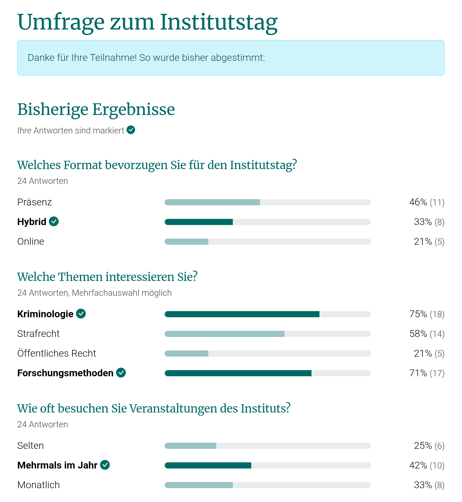

# Umfragen und Danke-Seite

```{include} snippets/wiphint.md
```

## Die Danke-Seite

Nach dem Absenden eines Formulars kommen Besucher:innen auf seine Danke-Seite (`<Adresse des Formulars>/thank-you/`). Das gilt für alle Formulare.

* Sie zeigt den `Thank you text` des Formulars (Bereich "After submitting"). Ist keiner eingetragen, steht dort "Vielen Dank. Ihre Angaben wurden übermittelt."
* Ein erneutes Laden der Seite sendet das Formular nicht noch einmal ab.
* Nur wer das Formular gerade abgesendet hat, sieht die Danke-Seite, und nur 30 Minuten lang; alle anderen kommen zum Formular. So sieht an einem gemeinsam genutzten Rechner die nächste Person nicht die Antworten der vorherigen.
* Ein Link führt zurück zum (leeren) Formular, um es erneut auszufüllen.
* Eingebettete Formulare (`?embed=true`) bleiben eingebettet.

Im Editor zeigt die Vorschau im Modus "Landing page", wie die Danke-Seite aussieht.

## Ergebnisse anzeigen

Für Umfragen kann die Danke-Seite die bisherigen Ergebnisse zeigen:

1. Ein Formular mit Auswahlfragen anlegen: `Radio buttons`, `Drop down`, `Checkboxes`, `Multiple select` oder `Multiple Choice (typeahead)`.
1. Im Reiter "Content", Bereich "After submitting", die Option `Show poll results after submitting` anhaken.
1. Veröffentlichen.

Nach dem Absenden sehen Besucher:innen unter dem Danke-Text "Bisherige Ergebnisse": für jede Auswahlfrage, wie oft jede Antwort gewählt wurde, in Prozent und als Anzahl. Ihre eigenen Antworten sind markiert.



So werden die Zahlen berechnet:

* Gezählt werden alle Einsendungen des Formulars, auch die gerade abgesendete.
* "24 Antworten" unter einer Frage: so viele Einsendungen haben bei dieser Frage etwas gewählt. Die Prozente beziehen sich auf diese Zahl.
* Bei Fragen mit mehreren möglichen Antworten (`Checkboxes`, `Multiple select`, `Multiple Choice (typeahead)`) können die Prozente zusammen mehr als 100 ergeben; das steht dann unter der Frage ("Mehrfachauswahl möglich").
* Antworten auf andere Fragen (Freitext, E-Mail, Datum, Uploads usw.) werden nie angezeigt, da sie personenbezogene Daten enthalten können.

## Beispiel: Umfrage zum Institutstag

Vor dem nächsten Institutstag soll die Belegschaft über Format und Themen abstimmen.

1. Eine neue Formularseite "Umfrage zum Institutstag" anlegen.
1. Diese Formularfelder hinzufügen:

   | Field type | Label | Choices | Required |
   | --- | --- | --- | --- |
   | `Radio buttons` | Welches Format bevorzugen Sie für den Institutstag? | Präsenz, Hybrid, Online | ✓ |
   | `Checkboxes` | Welche Themen interessieren Sie? | Kriminologie, Strafrecht, Öffentliches Recht, Forschungsmethoden | |
   | `Radio buttons` | Wie oft besuchen Sie Veranstaltungen des Instituts? | Selten, Mehrmals im Jahr, Monatlich | |
   | `Multi-line text` | Anregungen | | |

   Die `Choices` jeweils eine pro Zeile eintragen, z.B. für die erste Frage:

   ```text
   Präsenz
   Hybrid
   Online
   ```

1. Im Bereich "After submitting" als `Thank you text` z.B. "Danke für Ihre Teilnahme! So wurde bisher abgestimmt:" eintragen und `Show poll results after submitting` anhaken.
1. Testen (siehe unten), Testeinsendungen löschen, veröffentlichen und den Link verteilen.

Die Danke-Seite zeigt dann die Ergebnisse der ersten drei Fragen, wie im Bild oben. Die "Anregungen" sind nur in den Einsendungen und im Export zu sehen.

## Tipps

* **Vor dem Start Testeinsendungen löschen.** Sie zählen sonst mit. Die Einsendungen eines Formulars lassen sich im Menü "Forms" auswählen und löschen.
* **`Radio buttons` statt `Drop down` für eine Antwort.** Ein `Drop down` zeigt die erste Antwortmöglichkeit vorausgewählt; wer die Frage überspringt, stimmt unbemerkt für sie.
* **Pflichtfragen** sorgen dafür, dass bei jeder Frage alle Teilnehmenden mitzählen.
* **Antwortmöglichkeiten nach dem Start nicht umbenennen.** Frühere Einsendungen mit der alten Bezeichnung zählen dann nicht mehr mit.
* **Mehrfach abstimmen** ist nicht ausgeschlossen: wer das Formular erneut ausfüllt, zählt erneut. Soll nur die Belegschaft abstimmen, die Seite unter *Status > Privatsphäre ändern* auf angemeldete Benutzer:innen beschränken; ein Captcha (Reiter "Settings") hält automatisierte Einsendungen ab.
* **Ergebnisse teilen:** Die Ergebnisse sieht nur, wer abgestimmt hat. Für einen Bericht die Einsendungen exportieren (Excel, CSV).
* Umfragen können auch [mehrere Schritte](structure.md#mehrstufige-formulare) haben.
