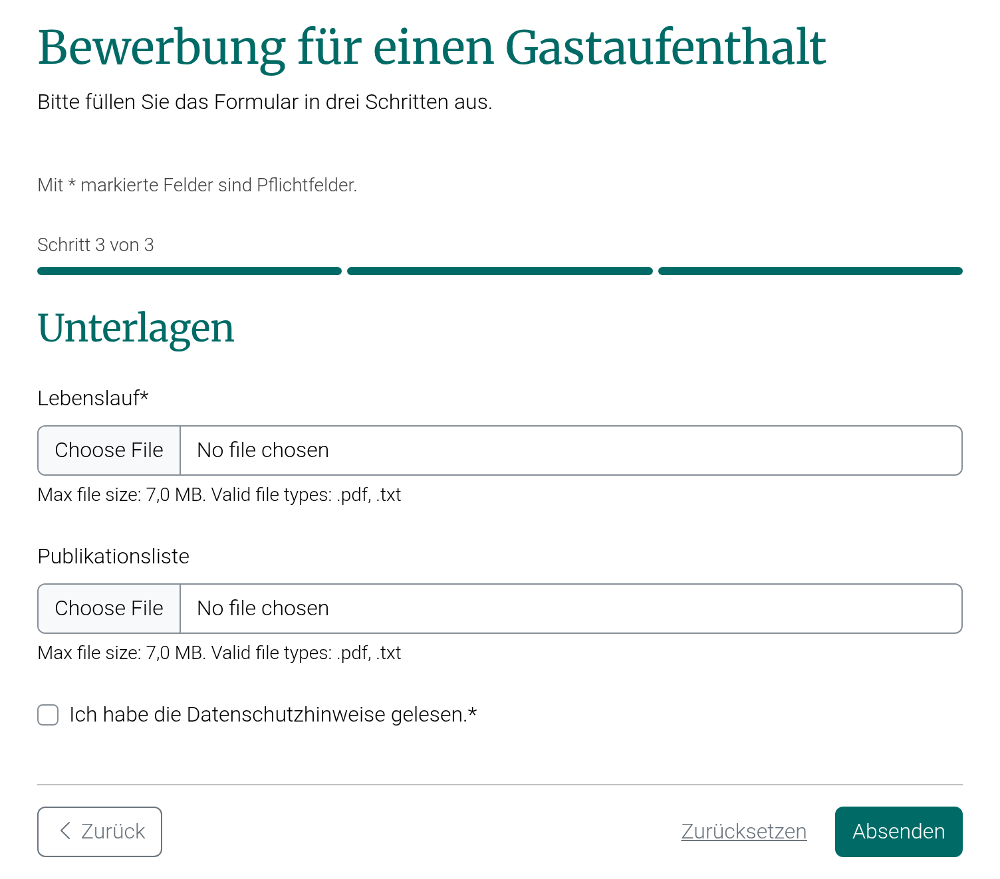

# Ein Formular strukturieren

```{include} snippets/wiphint.md
```

Lange Formulare werden übersichtlicher, wenn sie gegliedert sind. Dafür gibt es vier Mittel, vom kleinsten zum größten:

| Mittel | Wofür | Wo |
| --- | --- | --- |
| Trennlinien und Hervorhebungen | ein Feld absetzen oder einen Hinweis betonen | `CSS class names` eines Feldes |
| Zwischenüberschriften | zusammengehörige Felder gruppieren | `Heading` eines Feldes |
| Schritte | ein langes Formular in Abschnitte teilen, die nacheinander ausgefüllt werden | Formularfeld vom Typ `Page break (starts a new step)` |
| Intro- und Outro-Text | erklären, worum es geht, und vor dem Absenden informieren (z.B. Datenschutz) | `Intro text` und `Outro text` der Formularseite |

Faustregel: Bis etwa zehn Felder genügen Zwischenüberschriften. Hat ein Formular mehrere klar getrennte Teile (z.B. Angaben zur Person, Vorhaben, Unterlagen), lohnen sich Schritte.

## Zwischenüberschriften

Das Attribut `Heading` eines Feldes setzt eine Überschrift über dieses Feld. Sie gilt für alle folgenden Felder bis zur nächsten Überschrift; es genügt also, sie beim ersten Feld einer Gruppe einzutragen.

Ein Formular für eine Veranstaltung könnte so gegliedert sein:

| Feld | `Heading` |
| --- | --- |
| Name | Kontakt |
| E-Mail | |
| Teilnahme an (Checkboxes: Vortrag, Workshop, Abendessen) | Programm |
| Ernährung (Radio buttons) | |
| Anmerkungen | Sonstiges |

## Trennlinien und Hervorhebungen

Über `CSS class names` lässt sich z.B. eine Trennlinie vor einem Feld setzen (`border-top pt-2 mt-2`) oder ein Feld als Hinweis hervorheben (`alert alert-info`). Weitere Klassen unter [Felder](fields.md), Attribut `CSS class names`.

## Mehrstufige Formulare

Ein Formularfeld vom Typ `Page break (starts a new step)` (Seitenumbruch) teilt ein Formular in Schritte. Alle Felder bis zum nächsten Seitenumbruch bilden einen Schritt. Ein Seitenumbruch hat kein `Label`; seine `Heading` (optional) ist die Überschrift des neuen Schritts.



So erleben Besucher:innen das Formular:

* Sie sehen jeweils einen Schritt, mit einer Fortschrittsanzeige ("Schritt 2 von 3") und den Schaltflächen "Zurück" und "Weiter".
* "Weiter" prüft die Angaben des aktuellen Schritts (Pflichtfelder, E-Mail-Format, Dateityp usw.). Fehler werden direkt im Schritt angezeigt.
* "Zurück" prüft nichts; alle Angaben bleiben erhalten, auch ausgewählte Dateien.
* Erst im letzten Schritt wird das Formular abgesendet, mit den Angaben aller Schritte, als eine einzige Einsendung. Das Captcha (falls aktiviert) und der `Outro text` stehen im letzten Schritt.

Für die Auswertung ändert sich nichts: Einsendungen, Export, E-Mail und API enthalten die Antworten aller Schritte, ohne Seitenumbrüche.

Im Editor zeigt die Titelzeile eines Seitenumbruchs seine Überschrift und den Schritt, den er beginnt (z.B. "Schritt 2"). So ist die Gliederung auch bei eingeklappten Feldern zu sehen; nach dem Verschieben oder Löschen eines Feldes wird sie sofort aktualisiert.

Regeln für Seitenumbrüche:

* Ein Seitenumbruch ganz am Anfang beginnt keinen neuen Schritt, er setzt nur die Überschrift des ersten Schritts.
* Mehrere Seitenumbrüche direkt hintereinander ergeben einen Schritt; die Überschrift des letzten gilt.
* Ein Seitenumbruch am Ende wird ignoriert.

```{admonition} Feldtyp nachträglich ändern
   :class: warning

   Ein gespeicherter Seitenumbruch kann nicht in ein Eingabefeld umgewandelt werden (und umgekehrt). Stattdessen das Feld löschen und ein neues anlegen.
```

### Beispiel: Bewerbung für einen Gastaufenthalt

Ein Formular in drei Schritten. Der erste Seitenumbruch steht ganz am Anfang und gibt dem ersten Schritt seine Überschrift.

| Field type | Label | Heading | Required |
| --- | --- | --- | --- |
| `Page break` | | Zu Ihrer Person | |
| `Single line text` | Name | | ✓ |
| `Email` | E-Mail-Adresse | | ✓ |
| `Single line text` | Heimatinstitution | | ✓ |
| `Page break` | | Ihr Vorhaben | |
| `Date` | Gewünschter Beginn | | ✓ |
| `Date` | Gewünschtes Ende | | ✓ |
| `Multi-line text` | Forschungsvorhaben (kurz) | | ✓ |
| `Page break` | | Unterlagen | |
| `Document file` | Lebenslauf | | ✓ |
| `Document file` | Publikationsliste | | |
| `Checkbox` | Ich habe die Datenschutzhinweise gelesen. | | ✓ |

Tipps:

* Pro Schritt ein Thema und eher wenige Felder; ein kurzer erster Schritt erleichtert den Einstieg.
* Die Überschrift eines Schritts sagt, worum es geht ("Ihr Vorhaben"), nicht nur "Schritt 2"; die Nummer zeigt die Fortschrittsanzeige.
* Upload-Felder können in jedem Schritt stehen. Die Dateien werden beim Wechsel zum nächsten Schritt geprüft und erst mit dem Absenden gespeichert.
